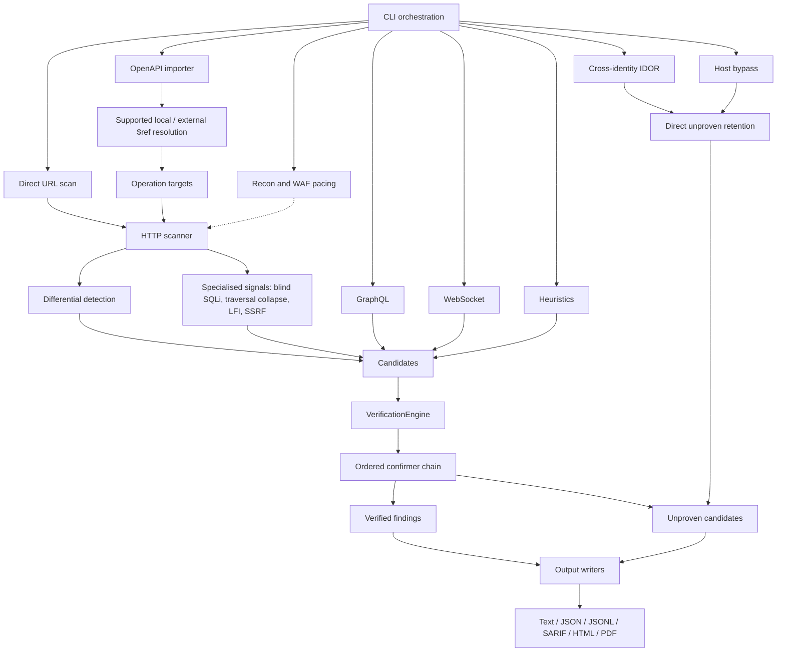

<p align="center">
  
</p>

<p align="center">
  <strong>SIGNAL OVER NOISE.</strong><br/>
  Differential DAST for teams who need results they can trust.
</p>

<p align="center">
  <a href="LICENSE"></a>
  <a href="https://python.org"></a>
  <a href="pyproject.toml"></a>
  <a href="https://pypi.org/project/janissary/"></a>
  <a href="BENCHMARK.md"></a>

</p>

—

> [!CAUTION]
> **Authorised use only.** JANISSARY is a dual-use security testing tool. Use it **only** against systems you own, or systems you have prior written permission to test. By running any network command you accept the [Terms of Use](LEGAL.md). Review with `janissary terms show`.

—

## Why JANISSARY

JANISSARY is an open-source DAST tool for discovering and investigating web application vulnerabilities, including API attack surfaces. It combines operation-level OpenAPI scanning, differential HTTP detection, specialised detection paths and machine-readable reporting for CI/CD workflows.

### API discovery and CI/CD reporting

Import OpenAPI 3.0.x or Swagger 2.0 definitions to enumerate operations and dispatch them to the HTTP scanner. Use dry-run mode to inspect imported targets without sending scan requests. Export findings as JSON, JSONL or SARIF 2.1.0 for downstream processing, or generate HTML and PDF reports.

The scan-level `completeness.scan_complete` field helps automation distinguish a completed scan from one that aborted, became incomplete, lost authentication, or left identified parameters without baselines. It reports only conditions the scanner tracks; it is not proof that every endpoint or attack surface was assessed.

### Differential detection, measured

Differential HTTP workflows compare candidate responses with baselines. Other discovery integrations may retain unproven candidates for review without promoting them to verified findings. On the OWASP Benchmark DAST-applicable corpus, the current **v7.11.1 result is F1 0.922** (precision 1.000, recall 0.855; TP 988 / FP 0 / FN 168 on 2,258 cases), **baseline-only**, single run. It clears the registered `--min-f1 0.92` gate. FN-recovery adds 0 findings at v7.11.1, so this baseline result matches the historical **v7.3.0 recovered headline F1 0.921** (TP 987) that required a second recovery pass. Precision 1.000 is scoped to the OWASP Benchmark corpus (0 FP across all runs to date); it does not establish a real-world false-positive rate, which remains the target of the M89 negative regression corpus. See [`BENCHMARK.md`](BENCHMARK.md) and Amendment 29.

### WAF-aware pacing

Detects Cloudflare, Akamai, Sucuri, Imperva, AWS WAF, F5, Barracuda, ModSecurity, Wordfence, and Fastly, then adapts request pacing on block signals and recovers on clean streaks. Getting blocked mid-scan wastes the scan.

### Multi-protocol coverage

HTTP, XML-RPC, GraphQL, and WebSocket, combined into a single agent run. OpenAPI operation dispatch is a separate HTTP scan path; it does not automatically invoke the other protocol or extension scans.

---

## At a glance

| Item | Details |
|---|---|
| **Version** | Source metadata 7.11.1 · latest GitHub release v7.11.0 · PyPI 7.10.2 |
| **API** | OpenAPI 3.0.x / Swagger 2.0 import · operation dispatch · dry-run enumeration |
| **Detection classes** | SQLi, XSS, SSRF, command injection, XPathi; traversal partial (recall 0.075) |
| **Access control** | Cross-identity IDOR comparison (candidate-only; not independently verified) |
| **Protocols** | HTTP, XML-RPC, GraphQL, WebSocket |
| **Output** | Text · JSON · JSONL · SARIF 2.1.0 · HTML · PDF |
| **CI/CD signal** | `completeness.scan_complete` plus tracked completion reasons |
| **Benchmark (OWASP)** | **0.922** DAST-applicable (v7.11.1, baseline-only, single run) · gate 0.92 cleared · **0.978** supported-classes (v7.11.1, supplemental; excludes path traversal) · precision 1.000 (0 FP) · historical v7.3.0 recovered: 0.921 |
| **Install** | `pip install janissary` (7.10.2) or clone for the 7.11.x line |

## What it does

| Area | Capability | Status |
|---|---|---|
| **Injection** | SQL injection (error, UNION, blind) · reflected XSS · command injection | ✅ shipped |
| | XPathi error and result-row detection paths | ⚠️ implemented; benchmark coverage not established |
| **Out-of-band** | SSRF via collaborator (Burp Pro / interactsh / interact.sh) · [docs](docs/ssrf.md) | ✅ shipped |
| | Cloud metadata SSRF (AWS / GCP / Azure) via response markers | ✅ shipped |
| **Path traversal** | Content-signature differential | ⚠️ partial (recall 0.075) |
| **API** | OpenAPI 3.0.x and Swagger 2.0 import, operation dispatch and dry-run enumeration | ✅ shipped |
| **Access control** | Cross-identity IDOR response comparison | ⚠️ candidate-only; not independently verified |
| **Recon** | CMS and technology fingerprinting · 18-platform admin probe | ✅ shipped |
| **Protocols** | HTTP, XML-RPC, GraphQL, WebSocket | ✅ shipped |
| **Additional checks** | Host-header bypass checks · heuristic scan mode | ✅ shipped |
| **Orchestration** | Agent: fingerprint → WAF → KB → modules → findings | ✅ shipped |
| **Reporting** | Text · JSON · JSONL · SARIF 2.1.0 · HTML · PDF | ✅ shipped |
| **Opt-in attack** | UNION extractor · Nuclei runner (both gated) | ✅ shipped |
| **Gaps** | JWT · prototype pollution | ❌ not implemented |

## Architecture

JANISSARY separates discovery from verification. Discovery identifies behaviours worth investigating; the verification boundary determines whether a candidate qualifies as a verified finding. Some observations are retained as unproven candidates without passing through that boundary.

Where a workflow routes through the `VerificationEngine`, the configured confirmer order is: Corroborator -> WebSocket -> GraphQL -> Heuristic -> IDOR -> AnalyzerImplicit. Specific unproven-classifying confirmers run before the unconditional fallback. The order matters: a later confirmer cannot override an earlier one's classification.

OpenAPI import is an input and dispatch path. The importer supports OpenAPI 3.0.x and Swagger 2.0, enumerates operations, and resolves local and external `$ref` chains in path-item and parameter entries. It does not resolve every possible reference location. Normal execution dispatches imported operations to the HTTP scanner; `--dry-run` only enumerates targets. OpenAPI scans do not automatically run the separate GraphQL, WebSocket, host-bypass, heuristic or IDOR phases.



The `VerificationEngine` is the production boundary for candidates routed through it. Its confirmer chain can accept a candidate as verified, retain it as unproven, or reject it. A `FailedVerification` is an engine result, not a third finding status. Host-bypass observations can be retained directly as unproven candidates.

`verified` means a configured confirmer accepted the candidate under JANISSARY's rules; it is not a guarantee of independent exploitability. IDOR comparisons are candidate-only: two successful responses with identical bodies or body lengths within 5% do not prove that the resource should have been inaccessible.

Specialised detection paths include blind SQLi, traversal response collapse, LFI content injection and SSRF response behaviour. HTML structural comparison uses selectolax and a 64-bit SimHash over tag shingles, with mmh3 when available and a blake2b fallback. These mechanisms do not imply uniform coverage across vulnerability classes.

## See it work


One real SQL injection, scanned with `janissary scan`:

```text
$ janissary scan -u "http://localhost:5001/sqli?q=test" -p q

[*] Scanning http://localhost:5001/sqli?q=test
[*] Parameters: q
[*] Baseline samples: 10

[*] Probing for WAF...
    No WAF signatures observed
  [q] baseline is static - timing gates disabled
  [q] sql_single_quote -> CRITICAL: db_error | SQLITE error signature matched
  [q] sql_union_null  -> HIGH: status_change | Baseline 200 -> Payload 500
  ...

============================================================
SCAN SUMMARY
============================================================
  Target:          http://localhost:5001/sqli?q=test
  Parameters:      q
  Method:          GET
  Total requests:  29
  Findings:        11 in 2 groups

  Findings:
    F-001  CRITICAL sqli:sql_injection  (param=q)
           - [sql_single_quote] db_error: SQLITE error signature matched
           - [sql_single_quote] status_change: Baseline 200 -> Payload 500
           - [sql_single_quote] length_anomaly: Response 3.6x baseline
           - [sql_or_1eq1]      length_anomaly: Response 3.8x baseline
           - [sql_union_null]   status_change: Baseline 200 -> Payload 500
           - [sql_union_null]   length_anomaly: Response 10.1x baseline
           - [sql_sleep_mysql]  status_change: Baseline 200 -> Payload 500
           - [sql_sleep_mysql]  length_anomaly: Response 3.3x baseline
           - [sql_sleep_pg]     status_change: Baseline 200 -> Payload 500
           - [sql_sleep_pg]     length_anomaly: Response 5.8x baseline

    F-002  LOW      sqli:reflection  (param=q)
           - [sql_single_quote] payload_reflected: Payload reflected (raw)

  Findings by severity:
    CRITICAL   1
    HIGH       4
    MEDIUM     5
    LOW        1
```

Eleven signals, **one bug**. Every piece of evidence for `F-001` points at the same SQL injection, so JANISSARY groups them. `F-002` is a different root cause (reflection) and stays separate. One finding to triage, with the receipts attached.

---

## Benchmark

> [!IMPORTANT]
> **Measurement status (Amendment 29).** The current DAST-applicable headline is **F1 0.922** (TP 988 / FP 0 / FN 168), from a single complete **v7.11.1 baseline-only** run at harness commit `ea7b3e5` (post-M80). It clears the registered `--min-f1 0.92` gate by 0.002. An FN-recovery rescan at `JANISSARY_TIMEOUT=180` added 0 findings; the residual 168 FN comprise 123 path-traversal cases and 45 cases across weakrand (16), securecookie (8), trustbound (16), and cmdi (5). The recovery rescan covered 146 DAST false negatives; 22 cases were mode-skipped before scanning, so zero new findings does not mean all 168 residual cases were rescanned (see [`docs/pathtraver.md`](docs/pathtraver.md)). The supported-classes supplemental at v7.11.1 is **F1 0.978**. The historical **v7.3.0 recovered headline was F1 0.921** (TP 987) and required a second recovery pass to reach the same level the current version achieves at baseline. Real-world false-positive rate, locked held-out precision, and independent external reproduction remain unclaimed. See [`BENCHMARK.md`](BENCHMARK.md) and Amendment 29.

| Metric | Value | Notes |
|---|---|---|
| **F1 (v7.11.1 baseline-only, single run)** | **0.922** | Clears registered gate 0.92 by 0.002 |
| **Precision** | **1.000 (0 FP)** | OWASP DAST-applicable corpus, all committed runs to date |
| **Recall (v7.11.1)** | **0.855** | TP 988 / FN 168 (DAST-applicable) |
| **TP / FP / FN / TN (v7.11.1)** | 988 / 0 / 168 / 1102 | DAST-applicable, baseline-only |
| F1 (with FN-recovery protocol) | 0.922 | Recovery added 0 findings across 146 of 168 rescanned DAST FNs (22 mode-skipped before scan) at v7.11.1 |
| F1 (supported-classes, excl. path-traversal) | 0.978 | v7.11.1; excludes pathtraver TP 10 / FN 123 (ADR-027 D8 amended) |
| **Historical v7.3.0 recovered F1** | **0.921** | TP 987; required FN-recovery pass to achieve |
| Historical 3-run unassisted F1 (v7.3.0) | 0.903 ± 0.009 | Last 3-run protocol measurement was v7.5.0 (0.906 ± 0.002) |
| Categories at F1 = 1.000 | 20 | Of 33 DAST-applicable categories |

Reproduce:

```bash
# Score the committed v7.11.1 measurement without rerunning it:
python benchmark/track_a/score_dast_aware.py \
    benchmark/track_a/runs/20261112T180530Z-janissary-r1

# For a fresh run, copy the example configuration and edit it:
cp benchmark/track_a/tools.env.example benchmark/track_a/tools.env
# Set JANISSARY_TIMEOUT=60 and TARGET_VERSION=20cbf3d in tools.env.

# Run against the benchmark target; the runner prints the new run directory:
python -m benchmark.track_a.runner \
    --tool janissary --run-number 1 \
    --target-base http://127.0.0.1:8080/benchmark \
    --cases-csv benchmark/track_a/case_vectors.csv \
    --tools-env benchmark/track_a/tools.env

# Score the exact directory printed by the runner above:
RUN_DIR="paste-the-exact-run-directory-printed-by-the-runner"
python benchmark/track_a/score_dast_aware.py "$RUN_DIR"
```

### What this measurement does and does not claim

- ✅ **Measured on v7.11.1** (2026-11-13, commit `ea7b3e5`, post-M80): single complete baseline-only corpus run, 0 FP, F1 0.922, gate 0.92 cleared. Run artifacts committed under `benchmark/track_a/runs/20261112T180530Z-janissary-r1/`.
- ✅ **Historical recovered headline:** v7.3.0, F1 0.921 (TP 987), the product of baseline + FN-recovery. The v7.11.1 baseline matches this level with recovery adding 0 findings across 146 of the 168 residual DAST false negatives; 22 cases were mode-skipped before scanning and remain structurally unreachable at any timeout — the improvement from Amendments 12–19 removed the timeout-sensitive misses that required recovery at v7.3.0.
- ⚠️ **Not claimed:** real-world false-positive rate, held-out precision, competitor comparison, independent external reproduction. Those remain Phase 3/4 items under [`docs/AMENDMENT-23.md`](docs/AMENDMENT-23.md). The `0.922` headline is a single run, not a 3-run mean; `0.921` remains the historical recovered figure.

See [`LIMITATIONS.md`](LIMITATIONS.md) for what JANISSARY can and cannot prove. See [`docs/decisions/`](docs/decisions/) for the architectural decision record.

---

## Install

```bash
# PyPI releases are at 7.10.2. The 7.11.x line (WebSocket, host-bypass,
# heuristics, SARIF two-run, tri-session auth, IDOR, crAPI, SSRF metadata)
# is on git main, not yet on PyPI.
pip install janissary

# For the 7.11.x line:
git clone https://github.com/Hetaireia/janissary.git
cd janissary
pip install -e .
```

---

## Quickstart

Accept the Terms of Use (required once before any network command):

```bash
janissary terms accept
```

Scan a single endpoint:

```bash
janissary scan -u "https://target.example/sqli?q=test" -p q
```

Scan a Git repository for leaked credentials:

```bash
janissary creds ./my-repo --scan-git
```

Fingerprint a target:

```bash
janissary fingerprint https://target.example
```

Probe for admin panels:

```bash
janissary admin https://target.example
```

---

## Commands

| Command | What it does |
|---|---|
| `scan` | HTTP scanning: SQLi, XSS, SSRF, traversal, cmdi |
| `creds` | Credential discovery in tree or Git history |
| `fingerprint` | CMS and technology identification |
| `graphql` | GraphQL detection and field enumeration |
| `ws` | WebSocket recon |
| `admin` | Admin panel discovery, 18 platforms |
| `agent` | Orchestrates recon, persists findings |
| `terms` | Show, check, or accept Terms of Use |
| `attack sqli-union` | UNION extractor (gated) |
| `attack nuclei` | Nuclei runner (gated) |

Run `janissary --help` for full flags.

---

## Scope, authentication, and machine-readable output

### Scope enforcement

Hunters run against bug-bounty programs whose scope is contractual. `--scope-include` and `--scope-exclude` refuse to touch anything outside the declared boundary — before any network I/O, with exit code 64 and empty stdout.

```bash
# Only scan example.com and its subdomains, never admin.example.com
janissary scan -u "https://api.example.com/v1/items?id=1" -p id \
  --scope-include "*.example.com" \
  --scope-exclude "admin.example.com"

# Internal network, CIDR-based
janissary scan -u "http://10.1.2.3/" -p q --scope-include "10.0.0.0/8"
```

Deny always beats allow. Pattern syntax: `example.com`, `*.example.com`, `10.0.0.0/8`, `10.0.0.5`, `/api/`, `https://api.example.com/v1/`, or `*` for any. If no `--scope-include` is given, everything passes the include check; excludes still apply.

### Authentication

Static cookie and bearer-token headers apply to every request in the scan: WAF probes, preflight, baselines, and payloads.

```bash
janissary scan -u "https://app.example.com/profile?id=1" -p id \
  --cookie "session=abc123; csrf=xyz"

janissary agent https://app.example.com --attack-confirm \
  --bearer "eyJhbGciOi..."
```

`--redact-auth` swaps `Authorization` and `Cookie` header values with `[REDACTED]` in JSON/JSONL output only. Body content is untouched — a leaked secret inside a response body is often the actual bug. Use this before pasting scan output into a bug report.

Scans with `--cookie` or `--bearer` abort with exit code 2 when two consecutive HTTP 401 responses arrive mid-scan. Findings collected before the abort are preserved, and `abort_reason` names the threshold, param, and last payload attempted, so an expired session is reported cleanly rather than producing false negatives.

### Machine-readable output

`--json` emits one envelope document to stdout. `--jsonl` emits one finding per line. Both reserve stdout for the machine payload; every human status line (progress, WAF feedback, backoff) goes to stderr. `--quiet` silences stderr only — it never affects stdout.

```bash
# One document, all findings
janissary scan -u "https://target.example/?q=1" -p q --json > scan.json

# Streaming, filter with jq
janissary scan -u "https://target.example/?q=1" -p q --jsonl | jq -c .
```

Every finding carries `raw_request` and `raw_response` as HTTP/1.1 text with CRLF line endings, ready to paste into Burp Repeater.

SARIF 2.1.0 export is available via `--export *.sarif` on `scan` and `agent`. Output is catalog-driven with CWE taxonomy and cross-run partialFingerprints, suitable for CI/CD and GitHub code scanning.

Both JSON and JSONL preserve the verified/candidate distinction. The JSON envelope carries separate top-level `findings` and `candidates` arrays with independent counts. JSONL tags each record with a `record_type` field of `"verified"` or `"candidate"`. HTML and PDF reports render the two streams separately. SARIF exports both as separate runs (verified and discovery). A candidate cannot silently become a verified finding at the emitter boundary.

`total_requests` is a **mixture of measured and estimated counts**. Sites that issue HTTP calls increment the field per call. Sites that delegate to a sub-module without HTTP instrumentation (XPathi, IDOR, host-bypass, WebSocket protocol probes, GraphQL detect and probe stages) add a fixed or formula-based estimate for the intended work. The field is a floor suitable for display and rough budgeting, not a byte-accurate request ledger; consumers requiring precise counts must instrument the HTTP layer directly.

---

## Attack modules

The `attack` subcommands are opt-in. They require `--attack-confirm` in addition to the Terms-of-Use gate. Neither alone is enough.

- **`attack sqli-union`** — extracts DBMS version, current database, database list, and table list from a vulnerable parameter. Hard limits: 32 columns, 100 rows, 64 KB. Aborts on instability.
- **`attack nuclei`** — shells out to the Nuclei binary, streams JSONL, parses findings. Requires an explicit template list; refuses to run Nuclei's default set.

## Agent

The `agent` command ties the recon modules together: fingerprint, detect WAF, consult the platform knowledge base, run applicable modules, persist findings.

```bash
janissary agent https://target.example --attack-confirm
```

---

## What JANISSARY is not

Being explicit about scope is part of being honest about precision:

- **Not a crawler.** You point it at a URL and parameters. It scans those. A crawler is conditional on ADR-021 triggers (named enterprise demand or 3+ user asks) and is not present in the current release.
- **Not an enterprise platform.** No SSO, no RBAC, no scheduled scans, no support SLA.
- **Not a full OWASP Top 10 scanner yet.** SQLi, XSS, SSRF, and partial traversal ship today. JWT and prototype pollution are not implemented and have no committed delivery date — see Known Limitations for the honest current state of each gap.
- **Not a replacement for Burp.** Complementary. Findings carry raw HTTP/1.1 so you can paste them into Repeater and finish the job.

---

## Known Limitations

*Honesty over assumptions. These are actively tracked, known issues.*

- **SPA Catch-All False Positives (Issue #1).** Applications returning HTTP 200 for arbitrary routes can trigger the admin-panel probe's initial status-code classifier. The probe runs a structural DOM differential against the root page (ADR-005 gated corroborator: `root_fingerprint` + hamming-distance threshold + `root_signature_match`) before emission — candidates failing the structural gate are discarded. Residual FP surface: SPA routes whose DOM matches the root page closely enough to pass the structural gate but which are not actual admin panels. No React/Angular/Vue regression corpus exists yet (L01 remaining gap).
- **Mid-scan auth expiry (ADR-010).** Two consecutive 401 responses *when auth is configured* abort the scan with `scan_incomplete=1` and an `auth expired: N consecutive HTTP 401 responses (param=..., last payload=...)` reason. Single 401s and 401s when no auth is configured do not abort. There is no separate `auth_required` output state — structured `ScanSummary.auth_state` is emitted (`unknown`/`authenticated`/`unauthenticated`/`expired`/`recovery_failed`) and rendered on abort; no `AuthStateManager` (health checks, reauth, OAuth2 refresh) exists yet, so an `expired` session cannot return to `authenticated`.
- **Framework-specific SQLi (L03) is not implemented.** JANISSARY recognises database error patterns across multiple SQL dialects, but does not yet provide ORM profiles, dialect-keyed payload selection or framework-specific delivery-path analysis. The failure-classification design and run-level record schema are documented in [`docs/l03_sqli_classification.md`](docs/l03_sqli_classification.md) and [`docs/l03_sqli_record_schema.md`](docs/l03_sqli_record_schema.md). The SQLi-specific record producer and final measurement-protocol implementation remain future work.
- **Path traversal — partial, recall 0.075** (per-subcategory F1 0.049—0.308). Scored in the DAST-applicable metric (0.922 headline); excluded from the supported-classes metric (0.978) per ADR-027 D8 amended (2026-11-05). Content-signature gates exist but are narrow. Documented in [`docs/pathtraver.md`](docs/pathtraver.md) as a property of the benchmark target.
- **SSRF payload scope.** Nine payloads ship today: five OOB via collaborator (`ssrf_http`, `ssrf_https`, `ssrf_gopher`, `ssrf_dict`, `ssrf_dns_only`) and four cloud-metadata via response-body markers (`ssrf_metadata_aws`, `ssrf_metadata_aws_v6`, `ssrf_metadata_gcp`, `ssrf_metadata_azure`). The `file://` payload remains deferred; confidence-aware OOB attribution is not implemented (L05 remaining gap). See [`docs/ssrf.md`](docs/ssrf.md).
- **IDOR candidate detection.** The `--idor` workflow requires two identities and emits unproven candidates based on cross-identity response comparisons. It does not establish whether a resource is legitimately public. Public-resource candidates are intentionally retained for analyst triage; no automatic suppression heuristic is applied (ADR-031). Manual assessment is required.

---

## Contributing

See [`CONTRIBUTING.md`](CONTRIBUTING.md).

> [!CAUTION]
> **Reporting a vulnerability.** Do not open a public issue. Use the private disclosure channel in [`SECURITY.md`](SECURITY.md).

## Security

See [`SECURITY.md`](SECURITY.md).

---

## Roadmap

The architectural decisions governing current and planned work are in [`docs/decisions/`](docs/decisions/) (ADR-016 through ADR-021 for the Phase 0 Foundation, and prior ADRs for the verification engine itself).

Shipped discovery capabilities and deferred direction:

- **Heuristic discovery (Track B):** shipped as `--heuristic`. Heuristic matches pass through the `VerificationEngine` and are retained as unproven candidates where the configured confirmer classifies them that way. Discovery does not independently establish a verified vulnerability. See ADR-016, ADR-017 and ADR-019.
- **Crawler:** deferred with explicit triggers (named enterprise demand or 3+ user asks). When built, ships open-source. See ADR-021.

Detailed phased planning and milestone tracking are maintained privately and are not part of this repository.

---

## License

Apache 2.0 for the source code. See [`LICENSE`](LICENSE).

Use is additionally governed by the [Terms of Use](LEGAL.md), which supplement and do not replace the Apache 2.0 licence.

---

## Live WAF evidence

JANISSARY was run against OWASP Juice Shop behind ModSecurity + OWASP CRS. The scanner detected the WAF, received block signals, and paced requests without aborting the scan.

```text
[*] Probing for WAF...
    WAF detected: unknown (confidence 0.90)
[*] Initial inter-request delay: 2.80s
...
  WAF:
    detected=True vendor=None confidence=0.9
  Pacer:
    final_delay=30.0s events=38
  Findings:
    F-001  CRITICAL sqli:sql_injection  (param=q)
           - [sql_hash_comment] db_error: SQLITE error signature matched
```

Configuration: `docker-compose.waf.yml` (ModSecurity CRS reverse proxy in front of Juice Shop). This closes the gap between "architecturally paces" and "provably paces."

## Docker

```bash
docker run --rm oraclemode337/janissary:7.10.2 scan -u "https://target.example" -p q
```

The image exposes the same entrypoint as the PyPI package. Use `host.docker.internal` to reach services on the host from inside the container.
