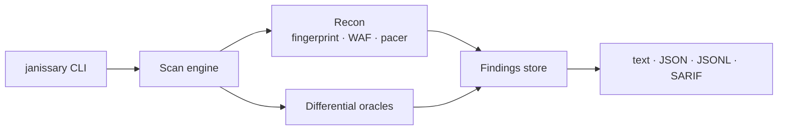

<p align="center">
  
</p>

<p align="center">
  <strong>SIGNAL OVER NOISE.</strong><br/>
  Differential DAST for teams who need results they can trust.
</p>

<p align="center">
  <a href="LICENSE"></a>
  <a href="https://python.org"></a>
  <a href="https://github.com/Hetaireia/janissary/tags"></a>
  <a href="https://pypi.org/project/janissary/"></a>
  <a href="BENCHMARK.md"></a>
  <a href="https://hub.docker.com/r/oraclemode337/janissary"></a>
</p>

—

> [!CAUTION]
> **Authorised use only.** JANISSARY is a dual-use security testing tool. Use it **only** against systems you own, or systems you have prior written permission to test. By running any network command you accept the [Terms of Use](LEGAL.md). Review with `janissary terms show`.

—

## Why JANISSARY

Most DAST tools are either expensive enterprise platforms or raw scripts that produce unusable noise. JANISSARY is different in three specific ways.

### Differential detection, measured

Every finding is gated by a baseline comparison — nothing emits from a single response. Measured against the OWASP Benchmark DAST-applicable corpus under the pre-registered methodology in [`BENCHMARK.md`](BENCHMARK.md): **precision 1.000** on dev splits (0 FP observed), **recall 0.854**, **F1 0.921**. Three baseline runs give a mean unassisted F1 of 0.903 ± 0.009; the FN-recovery pass at `JANISSARY_TIMEOUT=180` closes to 0.921. Run artifacts are committed under [`benchmark/track_a/runs/`](benchmark/track_a/runs/).

### WAF-aware pacing

Detects Cloudflare, Akamai, Sucuri, Imperva, AWS WAF, F5, Barracuda, ModSecurity, Wordfence, and Fastly, then adapts request pacing on block signals and recovers on clean streaks. Getting blocked mid-scan wastes the scan.

### Multi-protocol coverage

HTTP, XML-RPC, GraphQL, and WebSocket, combined into a single agent run.

—

## At a glance

| | |
|---|---|
| **Version** | 7.11.1 (git tag, 2026-11-06; PyPI and Docker Hub at 7.10.2) |
| **Benchmark (OWASP)** | **F1 0.921** all DAST-applicable · **0.977** supported-classes · **0.906 ± 0.002** unassisted (n=3) · Precision 1.000 (0 FP, n=3) |
| **Detection classes** | SQLi, XSS, SSRF, cmdi; traversal partial (recall 0.075 — see Known Limitations) |
| **Protocols** | HTTP, XML-RPC, GraphQL, WebSocket |
| **Output** | text · JSON · JSONL · SARIF 2.1.0 |
| **Install** | `pip install janissary` (7.10.2) or clone for the 7.11.x line |

—

## What it does

| Area | Capability | Status |
|---|---|---|
| **Injection** | SQL injection (error, union, blind) | ✅ shipped |
| | Reflected XSS | ✅ shipped |
| | Command injection | ✅ shipped |
| **Out-of-band** | SSRF via collaborator (Burp Pro / interactsh / interact.sh) | ✅ shipped · [docs](docs/ssrf.md) |
| | Cloud metadata SSRF (AWS / GCP / Azure) via body markers | ✅ shipped |
| **Path traversal** | Content-signature differential | ⚠️ partial (recall 0.075) |
| **Recon** | CMS and tech fingerprint · 18-platform admin probe | ✅ shipped |
| **Protocols** | HTTP, XML-RPC, GraphQL, WebSocket | ✅ shipped |
| **Orchestration** | Agent: fingerprint → WAF → KB → modules → findings | ✅ shipped |
| **Machine-readable** | text · JSON · JSONL · SARIF 2.1.0 | ✅ shipped |
| **Opt-in attack** | UNION extractor · Nuclei runner (both gated) | ✅ shipped |
| **Gaps** | JWT · prototype pollution | ❌ not implemented |

## Architecture



---

## See it work


One real SQL injection, scanned with `janissary scan`:

```text
$ janissary scan -u "http://localhost:5001/sqli?q=test" -p q

[*] Scanning http://localhost:5001/sqli?q=test
[*] Parameters: q
[*] Baseline samples: 10

[*] Probing for WAF...
    No WAF signatures observed
  [q] baseline is static - timing gates disabled
  [q] sql_single_quote -> CRITICAL: db_error | SQLITE error signature matched
  [q] sql_union_null  -> HIGH: status_change | Baseline 200 -> Payload 500
  ...

============================================================
SCAN SUMMARY
============================================================
  Target:          http://localhost:5001/sqli?q=test
  Parameters:      q
  Method:          GET
  Total requests:  29
  Findings:        11 in 2 groups

  Findings:
    F-001  CRITICAL sqli:sql_injection  (param=q)
           - [sql_single_quote] db_error: SQLITE error signature matched
           - [sql_single_quote] status_change: Baseline 200 -> Payload 500
           - [sql_single_quote] length_anomaly: Response 3.6x baseline
           - [sql_or_1eq1]      length_anomaly: Response 3.8x baseline
           - [sql_union_null]   status_change: Baseline 200 -> Payload 500
           - [sql_union_null]   length_anomaly: Response 10.1x baseline
           - [sql_sleep_mysql]  status_change: Baseline 200 -> Payload 500
           - [sql_sleep_mysql]  length_anomaly: Response 3.3x baseline
           - [sql_sleep_pg]     status_change: Baseline 200 -> Payload 500
           - [sql_sleep_pg]     length_anomaly: Response 5.8x baseline

    F-002  LOW      sqli:reflection  (param=q)
           - [sql_single_quote] payload_reflected: Payload reflected (raw)

  Findings by severity:
    CRITICAL   1
    HIGH       4
    MEDIUM     5
    LOW        1
```

Eleven signals, **one bug**. Every piece of evidence for `F-001` points at the same SQL injection, so JANISSARY groups them. `F-002` is a different root cause (reflection) and stays separate. One finding to triage, with the receipts attached.

---

## Benchmark

> [!IMPORTANT]
> **Measurement status (Amendment 23).** The 7.5.0 baseline was measured end-to-end on 2026-10-28 (three independent runs, fresh containers, single-process, same target). Figures below distinguish the **unassisted** score from the **FN-recovery-scored** figure. The unassisted figure is what a clean run reproduces; the recovery figure additionally re-scans FN cases at higher timeout per Amendment 20. The 95% upper bound on real-world false-positive rate, locked held-out precision, and external reproduction are pending. See [`docs/AMENDMENT-23.md`](docs/AMENDMENT-23.md) and [`artifacts/7.5.0-baseline/`](artifacts/7.5.0-baseline/).

| Metric | Value | Notes |
|---|---|---|
| **Precision (dev split, n=3)** | **1.000 (0 FP observed)** | Reproduced on 7.5.0, 2026-10-28 |
| **Recall (unassisted, n=3)** | **0.828 ± 0.004** | Sample std, DAST-applicable |
| **F1 (unassisted, n=3)** | **0.906 ± 0.002** | Sample std, DAST-applicable |
| F1 (with FN-recovery protocol) | 0.921 | TP 987 / FP 0 / FN 169 |
| F1 (supported-classes, excl. path-traversal) | 0.977 | Excludes pathtraver TP 10 / FN 123 (ADR-027 D8 amended) |
| 3-run unassisted baseline F1 (historical) | 0.903 ± 0.009 | 7.3.0; matched by 7.5.0 within 1σ |
| TP / FP / FN per run (r1 / r2 / r3) | 961/0/195 · 960/0/196 · 953/0/203 | DAST-applicable |
| Categories at F1 = 1.000 | 20 | Of 33 DAST-applicable categories |

Reproduce:

```bash
# From repo root, with target on http://127.0.0.1:8080/benchmark
python -m benchmark.track_a.runner \
    --tool janissary --run-number 1 \
    --target-base http://127.0.0.1:8080/benchmark \
    --cases-csv benchmark/track_a/case_vectors.csv \
    --tools-env artifacts/7.5.0-baseline/invocations/tools_default.env
python benchmark/track_a/score_dast_aware.py benchmark/track_a/runs/<run-dir>
```

### What this measurement does and does not claim

- ✅ **Measured on 7.5.0:** dev-split precision (0 FP in 3 independent runs).
- ⚠️ **Not claimed:** real-world false-positive rate, held-out precision, competitor comparison, independent reproduction. Those remain Phase 3/4 items under [`docs/AMENDMENT-23.md`](docs/AMENDMENT-23.md).
- The `0.921` headline reflects the **FN-recovery protocol** (Amendment 20). The **unassisted** 7.5.0 3-run mean is `0.906 ± 0.002`.

See [`LIMITATIONS.md`](LIMITATIONS.md) for what JANISSARY can and cannot prove. See [`docs/decisions/`](docs/decisions/) for the architectural decision record.

---

## Install

```bash
# PyPI releases are at 7.10.2. The 7.11.x line (WebSocket, host-bypass,
# heuristics, SARIF two-run, tri-session auth, IDOR, crAPI, SSRF metadata)
# is on git main, not yet on PyPI.
pip install janissary

# For the 7.11.x line:
git clone https://github.com/Hetaireia/janissary.git
cd janissary
pip install -e .
```

---

## Quickstart

Accept the Terms of Use (required once before any network command):

```bash
janissary terms accept
```

Scan a single endpoint:

```bash
janissary scan -u "https://target.example/sqli?q=test" -p q
```

Scan a Git repository for leaked credentials:

```bash
janissary creds ./my-repo --scan-git
```

Fingerprint a target:

```bash
janissary fingerprint https://target.example
```

Probe for admin panels:

```bash
janissary admin https://target.example
```

---

## Commands

| Command | What it does |
|---|---|
| `scan` | HTTP scanning: SQLi, XSS, SSRF, traversal, cmdi |
| `creds` | Credential discovery in tree or Git history |
| `fingerprint` | CMS and technology identification |
| `graphql` | GraphQL detection and field enumeration |
| `ws` | WebSocket recon |
| `admin` | Admin panel discovery, 18 platforms |
| `agent` | Orchestrates recon, persists findings |
| `terms` | Show, check, or accept Terms of Use |
| `attack sqli-union` | UNION extractor (gated) |
| `attack nuclei` | Nuclei runner (gated) |

Run `janissary --help` for full flags.

---

## Scope, authentication, and machine-readable output

### Scope enforcement

Hunters run against bug-bounty programs whose scope is contractual. `--scope-include` and `--scope-exclude` refuse to touch anything outside the declared boundary — before any network I/O, with exit code 64 and empty stdout.

```bash
# Only scan example.com and its subdomains, never admin.example.com
janissary scan -u "https://api.example.com/v1/items?id=1" -p id \
  --scope-include "*.example.com" \
  --scope-exclude "admin.example.com"

# Internal network, CIDR-based
janissary scan -u "http://10.1.2.3/" -p q --scope-include "10.0.0.0/8"
```

Deny always beats allow. Pattern syntax: `example.com`, `*.example.com`, `10.0.0.0/8`, `10.0.0.5`, `/api/`, `https://api.example.com/v1/`, or `*` for any. If no `--scope-include` is given, everything passes the include check; excludes still apply.

### Authentication

Static cookie and bearer-token headers apply to every request in the scan: WAF probes, preflight, baselines, and payloads.

```bash
janissary scan -u "https://app.example.com/profile?id=1" -p id \
  --cookie "session=abc123; csrf=xyz"

janissary agent https://app.example.com --attack-confirm \
  --bearer "eyJhbGciOi..."
```

`--redact-auth` swaps `Authorization` and `Cookie` header values with `[REDACTED]` in JSON/JSONL output only. Body content is untouched — a leaked secret inside a response body is often the actual bug. Use this before pasting scan output into a bug report.

Scans with `--cookie` or `--bearer` abort with exit code 2 when two consecutive HTTP 401 responses arrive mid-scan. Findings collected before the abort are preserved, and `abort@U@reason` names the threshold, param, and last payload attempted, so an expired session is reported cleanly rather than producing false negatives.

### Machine-readable output

`--json` emits one envelope document to stdout. `--jsonl` emits one finding per line. Both reserve stdout for the machine payload; every human status line (progress, WAF feedback, backoff) goes to stderr. `--quiet` silences stderr only — it never affects stdout.

```bash
# One document, all findings
janissary scan -u "https://target.example/?q=1" -p q --json > scan.json

# Streaming, filter with jq
janissary scan -u "https://target.example/?q=1" -p q --jsonl | jq -c .
```

Every finding carries `raw@U@request` and `raw@U@response` as HTTP/1.1 text with CRLF line endings, ready to paste into Burp Repeater.

SARIF 2.1.0 export is available via `--export *.sarif` on `scan` and `agent`. Output is catalog-driven with CWE taxonomy and cross-run partialFingerprints, suitable for CI/CD and GitHub code scanning.

---

## Attack modules

The `attack` subcommands are opt-in. They require `--attack-confirm` in addition to the Terms-of-Use gate. Neither alone is enough.

- **`attack sqli-union`** — extracts DBMS version, current database, database list, and table list from a vulnerable parameter. Hard limits: 32 columns, 100 rows, 64 KB. Aborts on instability.
- **`attack nuclei`** — shells out to the Nuclei binary, streams JSONL, parses findings. Requires an explicit template list; refuses to run Nuclei's default set.

## Agent

The `agent` command ties the recon modules together: fingerprint, detect WAF, consult the platform knowledge base, run applicable modules, persist findings.

```bash
janissary agent https://target.example --attack-confirm
```

---

## What JANISSARY is not

Being explicit about scope is part of being honest about precision:

- **Not a crawler.** You point it at a URL and parameters. It scans those. A crawler is conditional on ADR-021 triggers (named enterprise demand or 3+ user asks) and is not present in the current release.
- **Not an enterprise platform.** No SSO, no RBAC, no scheduled scans, no support SLA.
- **Not a full OWASP Top 10 scanner yet.** SQLi, XSS, SSRF, and partial traversal ship today. JWT and prototype pollution are not implemented and have no committed delivery date — see Known Limitations for the honest current state of each gap.
- **Not a replacement for Burp.** Complementary. Findings carry raw HTTP/1.1 so you can paste them into Repeater and finish the job.

---

## Known Limitations

*Honesty over assumptions. These are actively tracked, known issues.*

- **SPA Catch-All False Positives (Issue #1).** Applications returning HTTP 200 for arbitrary routes can trigger the admin-panel probe's initial status-code classifier. The probe runs a structural DOM differential against the root page (ADR-005 gated corroborator: `root@U@fingerprint` + hamming-distance threshold + `root@U@signature@U@match`) before emission — candidates failing the structural gate are discarded. Residual FP surface: SPA routes whose DOM matches the root page closely enough to pass the structural gate but which are not actual admin panels.
- **Mid-scan auth expiry (ADR-010).** Two consecutive 401 responses *when auth is configured* abort the scan with `scan@U@incomplete=1` and an `auth expired: N consecutive HTTP 401 responses (param=..., last payload=...)` reason. Single 401s and 401s when no auth is configured do not abort. There is no separate `auth@U@required` output state — the abort reason string is the only signal.
- **Framework-Specific SQLi.** Payloads handle parenthesised SQL queries (Juice Shop), but ORM-specific edge cases remain a constant target for improvement.
- **Path traversal — partial, recall 0.075** (per-subcategory F1 0.049—0.308). Scored in the DAST-applicable metric (0.921 headline); excluded from the supported-classes metric (0.977) per ADR-027 D8 amended (2026-11-05). Content-signature gates exist but are narrow. Documented in [`docs/pathtraver.md`](docs/pathtraver.md) as a property of the benchmark target.
- **SSRF payload scope.** Nine payloads ship today: five OOB via collaborator (`ssrf@U@http`, `ssrf@U@https`, `ssrf@U@gopher`, `ssrf@U@dict`, `ssrf@U@dns@U@only`) and four cloud-metadata via response-body markers (`ssrf@U@metadata@U@aws`, `ssrf@U@metadata@U@aws@U@v6`, `ssrf@U@metadata@U@gcp`, `ssrf@U@metadata@U@azure`). The `file://` payload remains deferred. See [`docs/ssrf.md`](docs/ssrf.md).
- **IDOR candidate detection ships in M42.** Insecure Direct Object Reference candidates surfaced as unproven findings via `--idor` (requires two identities). Cross-identity probes, not full exploitation; manual triage required. See [`docs/decisions/ADR-024-idor-candidate-probe.md`](docs/decisions/ADR-024-idor-candidate-probe.md).

---

## Contributing

See [`CONTRIBUTING.md`](CONTRIBUTING.md).

> [!CAUTION]
> **Reporting a vulnerability.** Do not open a public issue. Use the private disclosure channel in [`SECURITY.md`](SECURITY.md).

## Security

See [`SECURITY.md`](SECURITY.md).

---

## Roadmap

The architectural decisions governing current and planned work are in [`docs/decisions/`](docs/decisions/) (ADR-016 through ADR-021 for the Phase 0 Foundation, and prior ADRs for the verification engine itself).

Two near-term direction items are captured as ADRs:

- **Heuristic discovery mode (Track B):** planned as `--heuristic` flag; emits candidates marked `unproven` in a separate SARIF run. Never promotes to verified findings without engine corroboration. See ADR-016, ADR-017, ADR-019.
- **Crawler:** deferred with explicit triggers (named enterprise demand or 3+ user asks). When built, ships open-source. See ADR-021.

Detailed phased planning and milestone tracking are maintained privately and are not part of this repository.

---

## License

Apache 2.0 for the source code. See [`LICENSE`](LICENSE).

Use is additionally governed by the [Terms of Use](LEGAL.md), which supplement and do not replace the Apache 2.0 licence.

---

## Live WAF evidence

JANISSARY was run against OWASP Juice Shop behind ModSecurity + OWASP CRS. The scanner detected the WAF, received block signals, and paced requests without aborting the scan.

```text
[*] Probing for WAF...
    WAF detected: unknown (confidence 0.90)
[*] Initial inter-request delay: 2.80s
...
  WAF:
    detected=True vendor=None confidence=0.9
  Pacer:
    final@U@delay=30.0s events=38
  Findings:
    F-001  CRITICAL sqli:sql_injection  (param=q)
           - [sql_hash_comment] db_error: SQLITE error signature matched
```

Configuration: `docker-compose.waf.yml` (ModSecurity CRS reverse proxy in front of Juice Shop). This closes the gap between "architecturally paces" and "provably paces."

## Docker

```bash
docker run --rm oraclemode337/janissary:7.10.2 scan -u "https://target.example" -p q
```

The image exposes the same entrypoint as the PyPI package. Use `host.docker.internal` to reach services on the host from inside the container.
