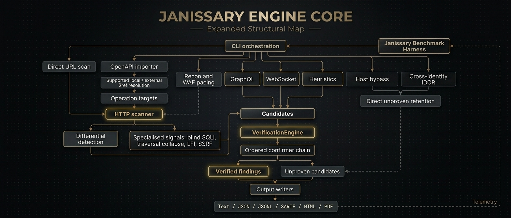

<p align="center">
  
</p>

<p align="center">
  
</p>

<p align="center">
  <a href="LICENSE"></a>
  <a href="https://python.org"></a>
  <a href="pyproject.toml"></a>
  <a href="https://pypi.org/project/janissary/"></a>
  <a href="BENCHMARK.md"></a>
</p>

---

> [!CAUTION]
> **Authorised use only.** JANISSARY is a dual-use security testing tool. Use it **only** against systems you own, or systems you have prior written permission to test. By running any network command you accept the [Terms of Use](LEGAL.md). Review with `janissary terms show`.

---

## Why JANISSARY

JANISSARY is an open-source DAST tool for discovering and investigating web application vulnerabilities, including API attack surfaces. It combines operation-level OpenAPI scanning, differential HTTP detection, specialised detection paths and machine-readable reporting for CI/CD workflows.

### API discovery and CI/CD reporting

Import OpenAPI 3.0.x or Swagger 2.0 definitions to enumerate operations and dispatch them to the HTTP scanner. Use dry-run mode to inspect imported targets without sending scan requests. Export findings as JSON, JSONL or SARIF 2.1.0 for downstream processing, or generate HTML and PDF reports.

The scan-level `completeness.scan_complete` field helps automation distinguish a completed scan from one that aborted, became incomplete, lost authentication, or left identified parameters without baselines. It reports only conditions the scanner tracks; it is not proof that every endpoint or attack surface was assessed.

### Differential detection, measured

Differential HTTP workflows compare candidate responses with baselines. Other discovery integrations may retain unproven candidates for review without promoting them to verified findings. On the OWASP Benchmark DAST-applicable corpus, the current **v7.11.1 result is F1 0.922** (precision 1.000, recall 0.855; TP 988 / FP 0 / FN 168 on 2,258 cases), **baseline-only**, single run. It clears the registered `--min-f1 0.92` gate. FN-recovery adds 0 findings at v7.11.1, so this baseline result matches the historical **v7.3.0 recovered headline F1 0.921** (TP 987) that required a second recovery pass. Precision 1.000 is scoped to the OWASP Benchmark corpus (0 FP across all runs to date); it does not establish a real-world false-positive rate, which remains the target of the M89 negative regression corpus. See [`BENCHMARK.md`](BENCHMARK.md) and Amendment 29.

### WAF-aware pacing

Detects Cloudflare, Akamai, Sucuri, Imperva, AWS WAF, F5, Barracuda, ModSecurity, Wordfence, and Fastly, then adapts request pacing on block signals and recovers on clean streaks. Getting blocked mid-scan wastes the scan.

### Multi-protocol coverage

HTTP, XML-RPC, GraphQL, and WebSocket, combined into a single agent run. OpenAPI operation dispatch is a separate HTTP scan path; it does not automatically invoke the other protocol or extension scans.

---

## At a glance

| Item | Details |
|---|---|
| **Version** | Source metadata 7.11.1 · latest GitHub release v7.11.0 · PyPI 7.10.2 |
| **API** | OpenAPI 3.0.x / Swagger 2.0 import · operation dispatch · dry-run enumeration |
| **Detection classes** | SQLi, XSS, SSRF, command injection, XPathi; traversal partial (recall 0.075) |
| **Access control** | Cross-identity IDOR comparison (candidate-only; not independently verified) |
| **Protocols** | HTTP, XML-RPC, GraphQL, WebSocket |
| **Output** | Text · JSON · JSONL · SARIF 2.1.0 · HTML · PDF |
| **CI/CD signal** | `completeness.scan_complete` plus tracked completion reasons |
| **Benchmark (OWASP)** | **0.922** DAST-applicable (v7.11.1, baseline-only, single run) · gate 0.92 cleared · **0.978** supported-classes (v7.11.1, supplemental; excludes path traversal) · precision 1.000 (0 FP) · historical v7.3.0 recovered: 0.921 |
| **Install** | `pip install janissary` (7.10.2) or clone for the 7.11.x line |

## Detection and capability matrix

| Capability | Public status | Documentation |
|---|---|---|
| Differential HTTP scanning | Implemented | Baselines and verification |
| OpenAPI 3.0.x | Implemented | Operation-level scanning |
| Swagger 2.0 | Implemented | Supported import |
| SQL injection | Implemented | Detection classes and limits |
| XSS | Implemented | Supported detection paths |
| XPath injection | Implemented | Avoid broad coverage claims |
| Command injection | Implemented | Available detection |
| Path traversal | Partial | Prominently disclose weak recall |
| SSRF | Partial | OOB and metadata-marker scope |
| GraphQL | Separate integration | Not automatic in every scan |
| WebSocket | Separate integration | Explicit invocation required |
| IDOR | Discovery candidates | Two identities, manual assessment |
| Host-header bypass | Discovery candidates | Separate from verified findings |
| Heuristic discovery | Discovery path | --heuristic and candidate status |
| Attack subcommands | Explicit opt-in | Separate from standard DAST |
| JWT / prototype pollution | Not yet supported | Out of implied coverage |

## Architecture

<p align="center">
  
</p>

JANISSARY separates discovery from verification. Discovery identifies behaviours worth investigating; the verification boundary determines whether a candidate qualifies as a verified finding. Some observations are retained as unproven candidates without passing through that boundary.

## See it work


One real SQL injection, scanned with `janissary scan`:

```text
$ janissary scan -u "http://localhost:5001/sqli?q=test" -p q

[*] Scanning http://localhost:5001/sqli?q=test
[*] Parameters: q
[*] Baseline samples: 10

[*] Probing for WAF...
    No WAF signatures observed
  [q] baseline is static - timing gates disabled
  [q] sql_single_quote -> CRITICAL: db_error | SQLITE error signature matched
  [q] sql_union_null  -> HIGH: status_change | Baseline 200 -> Payload 500
  ...

============================================================
SCAN SUMMARY
============================================================
  Target:          http://localhost:5001/sqli?q=test
  Parameters:      q
  Method:          GET
  Total requests:  29
  Findings:        11 in 2 groups

  Findings:
    F-001  CRITICAL sqli:sql_injection  (param=q)
           - [sql_single_quote] db_error: SQLITE error signature matched
           - [sql_single_quote] status_change: Baseline 200 -> Payload 500
           - [sql_single_quote] length_anomaly: Response 3.6x baseline
           - [sql_or_1eq1]      length_anomaly: Response 3.8x baseline
           - [sql_union_null]   status_change: Baseline 200 -> Payload 500
           - [sql_union_null]   length_anomaly: Response 10.1x baseline
           - [sql_sleep_mysql]  status_change: Baseline 200 -> Payload 500
           - [sql_sleep_mysql]  length_anomaly: Response 3.3x baseline
           - [sql_sleep_pg]     status_change: Baseline 200 -> Payload 500
           - [sql_sleep_pg]     length_anomaly: Response 5.8x baseline

    F-002  LOW      sqli:reflection  (param=q)
           - [sql_single_quote] payload_reflected: Payload reflected (raw)

  Findings by severity:
    CRITICAL   1
    HIGH       4
    MEDIUM     5
    LOW        1
```

Eleven signals, **one bug**. Every piece of evidence for `F-001` points at the same SQL injection, so JANISSARY groups them. `F-002` is a different root cause (reflection) and stays separate. One finding to triage, with the receipts attached.

---

## Benchmark results and methodology

### Primary benchmark — DAST-applicable corpus

**0.922** F1 score | **1.000** Precision | **0.855** Recall

| Measure | Result |
|---|---|
| True positives | 988 |
| False positives | 0 |
| False negatives | 168 |
| True negatives | 1,102 |
| DAST-applicable cases | 2,258 |

*Single baseline-only run. Benchmark precision is not a claim of zero false positives in real-world deployments.*

### Supplemental benchmark — supported classes

**0.978** F1 score | **1.000** Precision

Path traversal is excluded from this supplemental scope. This is not the all-DAST-applicable headline score.

### Path traversal disclosure

Path traversal detection is implemented, including a paired-probe existence oracle and verification through the normal finding boundary. However, measured recall on the current OWASP Benchmark path-traversal corpus is low (0.075). Path traversal remains included in the DAST-applicable headline score and is excluded from the supplemental supported-classes score, as defined by ADR-027. These scopes are reported separately to avoid obscuring the limitation.

### Benchmark qualifications

The headline result comes from a single baseline-only run. The `.922` figure is a rescore of committed artifacts, not a clean-exit reproduction. The original runner exited with code 1 and its attempt log was lost; the scoring arithmetic is reproducible against the committed `findings.jsonl` and `manifest.json`, but the run was not a clean-exit scan. The `.922` result clears the registered `.92` gate by a narrow margin. The `.978` result uses a different scoring scope. Neither result establishes a real-world false-positive rate. No statistical superiority claim is made against the historical v7.3.0 result. Refer to [BENCHMARK.md](BENCHMARK.md) for detailed methodology.

## What this measurement does and does not claim

- ✅ **Measured on v7.11.1** (2026-11-13, commit `ea7b3e5`, post-M80): single complete baseline-only corpus run, 0 FP, F1 0.922, gate 0.92 cleared. Run artifacts committed under `benchmark/track_a/runs/20261112T180530Z-janissary-r1/`.
- ✅ **Historical recovered headline:** v7.3.0, F1 0.921 (TP 987), the product of baseline + FN-recovery. The v7.11.1 baseline matches this level with recovery adding 0 findings across 146 of the 168 residual DAST false negatives; 22 cases were mode-skipped before scanning and remain structurally unreachable at any timeout — the improvement from Amendments 12–19 removed the timeout-sensitive misses that required recovery at v7.3.0.
- ⚠️ **Not claimed:** real-world false-positive rate, held-out precision, competitor comparison, independent external reproduction. Those remain Phase 3/4 items under [`docs/AMENDMENT-23.md`](docs/AMENDMENT-23.md). The `0.922` headline is a single run, not a 3-run mean; `0.921` remains the historical recovered figure.

See [`LIMITATIONS.md`](LIMITATIONS.md) for what JANISSARY can and cannot prove. See [`docs/decisions/`](docs/decisions/) for the architectural decision record.

---

## Installation

There are three supported installation methods. Choose the one that fits your use case. Do not execute them sequentially.

### PyPI (recommended for ordinary use)
```bash
pip install janissary
```

### Git (development and unreleased functionality)
```bash
git clone https://github.com/Hetaireia/janissary.git
cd janissary
pip install -e ".[dev]"
```

The 7.11.x line (WebSocket, host-bypass, heuristics, SARIF two-run, tri-session auth, IDOR, crAPI, SSRF metadata) is on git main. PyPI and Docker versions may not contain all main-branch features.

### Docker (isolated container deployment)
```bash
docker pull janissary/janissary:latest
```

## Quickstart

Accept the Terms of Use (required once before any network command):

```bash
janissary terms accept
```

Scan a single endpoint:

```bash
janissary scan -u "https://target.example/sqli?q=test" -p q
```

Scan a Git repository for leaked credentials:

```bash
janissary creds ./my-repo --scan-git
```

Fingerprint a target:

```bash
janissary fingerprint https://target.example
```

Probe for admin panels:

```bash
janissary admin https://target.example
```

---

## Commands

| Command | What it does |
|---|---|
| `scan` | HTTP scanning: SQLi, XSS, SSRF, traversal, cmdi |
| `creds` | Credential discovery in tree or Git history |
| `fingerprint` | CMS and technology identification |
| `graphql` | GraphQL detection and field enumeration |
| `ws` | WebSocket recon |
| `admin` | Admin panel discovery, 18 platforms |
| `agent` | Orchestrates recon, persists findings |
| `terms` | Show, check, or accept Terms of Use |
| `attack sqli-union` | UNION extractor (gated) |
| `attack nuclei` | Nuclei runner (gated) |

Run `janissary --help` for full flags.

---

## Scope, authentication, and machine-readable output

### Scope enforcement

Hunters run against bug-bounty programs whose scope is contractual. `--scope-include` and `--scope-exclude` refuse to touch anything outside the declared boundary — before any network I/O, with exit code 64 and empty stdout.

```bash
# Only scan example.com and its subdomains, never admin.example.com
janissary scan -u "https://api.example.com/v1/items?id=1" -p id \
  --scope-include "*.example.com" \
  --scope-exclude "admin.example.com"

# Internal network, CIDR-based
janissary scan -u "http://10.1.2.3/" -p q --scope-include "10.0.0.0/8"
```

Deny always beats allow. Pattern syntax: `example.com`, `*.example.com`, `10.0.0.0/8`, `10.0.0.5`, `/api/`, `https://api.example.com/v1/`, or `*` for any. If no `--scope-include` is given, everything passes the include check; excludes still apply.

### Authentication

Static cookie and bearer-token headers apply to every request in the scan: WAF probes, preflight, baselines, and payloads.

```bash
janissary scan -u "https://app.example.com/profile?id=1" -p id \
  --cookie "session=abc123; csrf=xyz"

janissary agent https://app.example.com --attack-confirm \
  --bearer "eyJhbGciOi..."
```

`--redact-auth` swaps `Authorization` and `Cookie` header values with `[REDACTED]` in JSON/JSONL output only. Body content is untouched — a leaked secret inside a response body is often the actual bug. Use this before pasting scan output into a bug report.

Scans with `--cookie` or `--bearer` abort with exit code 2 when two consecutive HTTP 401 responses arrive mid-scan. Findings collected before the abort are preserved, and `abort_reason` names the threshold, param, and last payload attempted, so an expired session is reported cleanly rather than producing false negatives.

### Machine-readable output

`--json` emits one envelope document to stdout. `--jsonl` emits one finding per line. Both reserve stdout for the machine payload; every human status line (progress, WAF feedback, backoff) goes to stderr. `--quiet` silences stderr only — it never affects stdout.

```bash
# One document, all findings
janissary scan -u "https://target.example/?q=1" -p q --json > scan.json

# Streaming, filter with jq
janissary scan -u "https://target.example/?q=1" -p q --jsonl | jq -c .
```

Every finding carries `raw_request` and `raw_response` as HTTP/1.1 text with CRLF line endings, ready to paste into Burp Repeater.

SARIF 2.1.0 export is available via `--export *.sarif` on `scan` and `agent`. Output is catalog-driven with CWE taxonomy and cross-run partialFingerprints, suitable for CI/CD and GitHub code scanning.

Both JSON and JSONL preserve the verified/candidate distinction. The JSON envelope carries separate top-level `findings` and `candidates` arrays with independent counts. JSONL tags each record with a `record_type` field of `"verified"` or `"candidate"`. HTML and PDF reports render the two streams separately. SARIF exports both as separate runs (verified and discovery). A candidate cannot silently become a verified finding at the emitter boundary.

`total_requests` is a **mixture of measured and estimated counts**. Sites that issue HTTP calls increment the field per call. Sites that delegate to a sub-module without HTTP instrumentation (XPathi, IDOR, host-bypass, WebSocket protocol probes, GraphQL detect and probe stages) add a fixed or formula-based estimate for the intended work. The field is a floor suitable for display and rough budgeting, not a byte-accurate request ledger; consumers requiring precise counts must instrument the HTTP layer directly.

---

## Optional integrations and advanced workflows

JANISSARY supports several integrations and attack workflows that are explicitly invoked and not part of the standard DAST quickstart.

### GraphQL
Requires explicit invocation. Tests real-time API introspection and injection flaws.

### WebSocket
Requires explicit invocation and payload input. Tests real-time communication channels.

### Host-header bypass
Runs discovery-based checks for Host header injection and routing bypasses. Retains findings as unproven candidates.

### IDOR
Requires two identities (--idor). Emits unproven candidates based on cross-identity response comparisons. Does not establish whether a resource is legitimately public. Manual assessment is required.

### Heuristic discovery
Uses --heuristic to enable broader discovery paths. Outputs unproven candidates.

### Attack subcommands
```bash
janissary attack sqli-union -u "https://target.example/?id=1" --attack-confirm
janissary attack nuclei -u "https://target.example" -t templates/ --attack-confirm
```

## What JANISSARY is not

Being explicit about scope is part of being honest about precision:

- **Not a crawler.** You point it at a URL and parameters. It scans those. A crawler is conditional on ADR-021 triggers (named enterprise demand or 3+ user asks) and is not present in the current release.
- **Not an enterprise platform.** No SSO, no RBAC, no scheduled scans, no support SLA.
- **Not a full OWASP Top 10 scanner yet.** SQLi, XSS, SSRF, and partial traversal ship today. JWT and prototype pollution are not implemented and have no committed delivery date — see Known Limitations for the honest current state of each gap.
- **Not a replacement for Burp.** Complementary. Findings carry raw HTTP/1.1 so you can paste them into Repeater and finish the job.

---

## Known limitations

*Honesty over assumptions. These are actively tracked, known issues.*

1. **Path traversal**: weak measured recall (0.075). Detection is implemented, but measured recall on the current corpus is low. Included in DAST-applicable and excluded from supported-classes.
2. **SPA catch-all behaviour**: possible false positives. The probe runs a structural DOM differential against the root page before emission. Residual FP surface: SPA routes whose DOM matches the root page closely enough to pass the structural gate.
3. **Authentication expiry**: two consecutive 401 responses (when auth is configured) abort the scan. No automatic token refresh or OAuth2 recovery exists yet.
4. **Framework-specific SQL injection**: recognises database error patterns, but framework-specific profiles and delivery-path analysis remain future work.
5. **SSRF**: current OOB and metadata-marker coverage. The file:// payload remains deferred; confidence-aware OOB attribution is not implemented.
6. **IDOR**: candidate-only discovery, two-identity requirement and manual assessment. No automatic suppression heuristic is applied (ADR-031).
7. **Completeness semantics**: `scan_complete=true` means no tracked incomplete condition was observed; it does not mean every possible attack vector was tested.

## Contributing

See [`CONTRIBUTING.md`](CONTRIBUTING.md).

> [!CAUTION]
> **Reporting a vulnerability.** Do not open a public issue. Use the private disclosure channel in [`SECURITY.md`](SECURITY.md).

## Security

See [`SECURITY.md`](SECURITY.md).

---

## Roadmap

The architectural decisions governing current and planned work are in [`docs/decisions/`](docs/decisions/) (ADR-016 through ADR-021 for the Phase 0 Foundation, and prior ADRs for the verification engine itself).

Shipped discovery capabilities and deferred direction:

- **Heuristic discovery (Track B):** shipped as `--heuristic`. Heuristic matches pass through the `VerificationEngine` and are retained as unproven candidates where the configured confirmer classifies them that way. Discovery does not independently establish a verified vulnerability. See ADR-016, ADR-017 and ADR-019.
- **Crawler:** deferred with explicit triggers (named enterprise demand or 3+ user asks). When built, ships open-source. See ADR-021.

Detailed phased planning and milestone tracking are maintained privately and are not part of this repository.

---

## License

Apache 2.0 for the source code. See [`LICENSE`](LICENSE).

Use is additionally governed by the [Terms of Use](LEGAL.md), which supplement and do not replace the Apache 2.0 licence.

---

## Live WAF evidence

JANISSARY was run against OWASP Juice Shop behind ModSecurity + OWASP CRS. The scanner detected the WAF, received block signals, and paced requests without aborting the scan.

```text
[*] Probing for WAF...
    WAF detected: unknown (confidence 0.90)
[*] Initial inter-request delay: 2.80s
...
  WAF:
    detected=True vendor=None confidence=0.9
  Pacer:
    final_delay=30.0s events=38
  Findings:
    F-001  CRITICAL sqli:sql_injection  (param=q)
           - [sql_hash_comment] db_error: SQLITE error signature matched
```

Configuration: `docker-compose.waf.yml` (ModSecurity CRS reverse proxy in front of Juice Shop). This closes the gap between "architecturally paces" and "provably paces."

## Docker

```bash
docker run --rm oraclemode337/janissary:7.10.2 scan -u "https://target.example" -p q
```

The image exposes the same entrypoint as the PyPI package. Use `host.docker.internal` to reach services on the host from inside the container.
